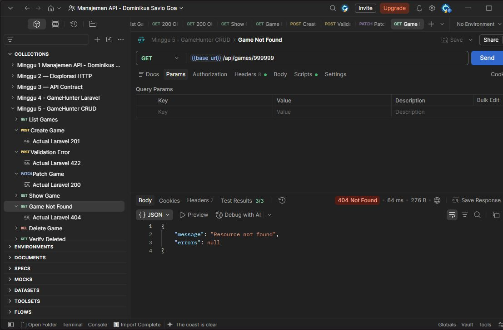

# Tugas 5 — CRUD Resource Utama

## 1. Tujuan

Menerapkan CRUD pada resource Game di project GameHunter dengan validasi, API Resource, dan response yang konsisten.

## 2. Perubahan

Saya melanjutkan hasil Praktikum 5. GameController menangani daftar, detail, tambah, ubah, dan hapus game. StoreGameRequest dan UpdateGameRequest memeriksa input. GameResource mengatur field JSON.

Title wajib 3–200 karakter, platform hanya pc/browser, dan is_free berupa boolean. Saat create, is_free boleh tidak dikirim dan bernilai false. Saat update, hanya field yang dikirim yang diubah. ID, source, dan timestamps ditentukan server.

Collection Postman di project lokal sudah diperbarui untuk delapan request, termasuk success dan error response.

## 3. Endpoint atau contract

Gunakan `Accept: application/json`, `Content-Type: application/json`, dan No Auth pada server lokal.

| Method | Endpoint | Response |
| --- | --- | --- |
| GET | /api/games | 200, daftar dalam array data |
| POST | /api/games | 201, game baru dalam object data |
| GET | /api/games/{id} | 200, detail; 404 jika tidak ada |
| PUT/PATCH | /api/games/{id} | 200, game diperbarui; 422 jika input salah |
| DELETE | /api/games/{id} | 204 tanpa body; 404 jika tidak ada |

Field response: id integer; title, platform, dan source string; is_free boolean; updated_at string ISO 8601. Game baru memakai source manual.

Saya memakai Form Request agar validasi terpisah dari controller. GameResource menjaga wrapper `data` dan tipe field tetap sesuai contract. DELETE memakai 204 tanpa body karena data sudah dihapus.

Contoh success response 201:

```json
{
  "data": {
    "id": 6,
    "title": "Game Praktikum CRUD",
    "platform": "pc",
    "is_free": true,
    "source": "manual",
    "updated_at": "2026-10-12T10:09:08.000000Z"
  }
}
```

## 4. Bukti pengujian

Bukti berikut berasal dari pengujian Praktikum 5 pada 12 Oktober 2026. Semua screenshot diambil setelah request dikirim di Postman, tanpa kursor dan sorot biru.

Hasil pengujian: **41 test Game, 132 assertion lulus**. Seluruh suite Pest: **43 test, 134 assertion lulus**. Newman: **8 request, 26 assertion lulus**.

POST game valid — 201 Created, 4/4 test Postman lulus.


POST title kosong dan platform console — 422.


PATCH is_free menjadi false — 200, 4/4 test lulus. Title dan platform tetap.


GET ID tidak ada — 404, 3/3 test lulus.



DELETE game pengujian — 204 tanpa body, 2/2 test lulus. GET ulang ID yang dihapus menghasilkan 404.


Untuk mencoba ulang, jalankan dari project Laravel lokal:

```bash
php artisan serve --host=127.0.0.1 --port=8000
```

Di Postman, kirim POST ke `http://127.0.0.1:8000/api/games`:

```json
{"title":"Game Praktikum CRUD","platform":"pc","is_free":true}
```

Catat ID response untuk GET, PATCH, dan DELETE. Body PATCH: `{"is_free":false}`. Pada terminal kedua, jalankan test:

```bash
php artisan test --compact tests/Feature/GameCrudTest.php tests/Feature/GameReadOnlyTest.php
```

## 5. Error case

Title kosong dan platform console menghasilkan 422:

```json
{
  "message": "The title field is required. (and 1 more error)",
  "errors": {
    "title": ["The title field is required."],
    "platform": ["The selected platform is invalid."]
  }
}
```

GET `/api/games/999999` menghasilkan 404:

```json
{"message":"Resource not found","errors":null}
```

Input gagal validasi tidak disimpan. Update dan delete untuk ID yang tidak ada juga menghasilkan 404.

## 6. Kesimpulan

CRUD GameHunter sudah berjalan dengan validasi dan response konsisten. Success dan error response sudah diuji. Repository ini berisi laporan dan gambar; kode Laravel serta collection Postman ada di project lokal `projek_api`. Tidak ada credential atau secret dalam laporan.

## 7. Referensi

- Instruksi Tugas 5 — CRUD Resource Utama.
- [Hasil Praktikum 5 — GameHunter](https://github.com/DonnyGoa09/Praktikum-Minggu-5-CRUD-GameHunter/blob/main/docs/minggu-5-praktikum.md).
- Contract GameHunter: endpoint, field, dan status code pada bagian 3.
- [Laravel Validation](https://laravel.com/framework/docs/13.x/validation), [API Resources](https://laravel.com/framework/docs/13.x/eloquent-resources), dan [Controllers](https://laravel.com/framework/docs/13.x/controllers).

## 8. Deklarasi penggunaan AI

AI membantu saya dalam praktikum dan langkah pengerjaan saat ada kendala.
